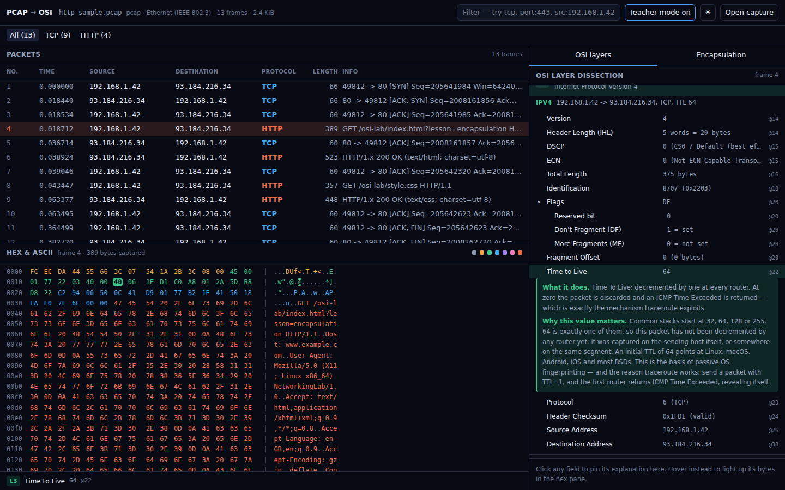
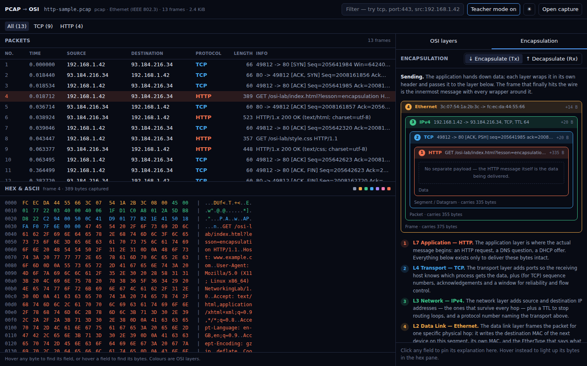
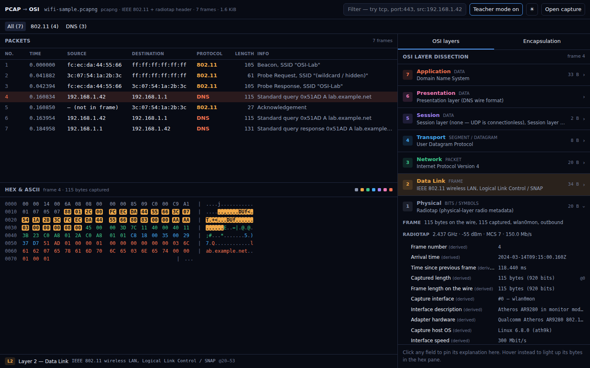

# PCAP-to-OSI Interactive Visualizer

Drop a packet capture into your browser and watch it come apart into the seven
OSI layers — byte by byte, field by field, with a plain-English explanation of
what every header field does and why its value in *this* packet matters.

**[Live demo](https://michaelperry.org/pcaposivisualizer.html)** ·
[GitHub Pages mirror](https://michaelaperry.github.io/pcaptoOSI/) ·
[Build the offline HTML](#running-it--pick-whichever-is-least-trouble)



Everything runs in the browser. There is no backend, no upload, no telemetry
and no network access at runtime: the file is read with `FileReader`, parsed in
JavaScript, and never leaves the machine. Load the page once and it keeps
working offline for the rest of the lesson.

## Try it in class

Open the [live visualizer](https://michaelperry.org/pcaposivisualizer.html) and
choose a bundled synthetic capture. Hover over a field to match
its explanation to the corresponding bytes in the hex pane.

For a second activity on the same subject, try the
[OSI Lesson Game](https://github.com/MichaelAPerry/OSI-Lesson-Game).

## Why this exists

Wireshark is a better packet analyser than this will ever be, and nobody should
switch. But it is built for engineers who already know how the OSI model maps
onto real protocols, so it labels the physical-layer metadata "Frame" and
leaves the seven-layer translation as an exercise. Students are examined on
that translation.

This tool does the one thing Wireshark deliberately doesn't: it takes a
position on which layer every single byte belongs to, colours it accordingly,
and explains the mapping — including all the places where the mapping is
awkward. It is a teaching instrument, not an analyser. There's no stream
reassembly, no decryption, no capture support. Point it at a capture and it
will tell you *why* the bytes look the way they do.

### Is the OSI model even worth teaching?

It's a fair objection, and the honest answer is that the seven-layer model
describes a protocol stack nobody deployed. The Internet runs on TCP/IP, which
has four layers, and mapping one onto the other produces exactly the confusion
this tool exists to address: two layers with no protocol of their own, a
physical layer that captures cannot see, and protocols like ARP and ICMP that
refuse to sit anywhere clean.

The response here is not to paper over that. The model is still the shared
vocabulary of every networking course, certification and job interview, so
students need it — but a tool that pretends TCP/IP matches it teaches the wrong
lesson twice. So this one shows where the model fits, shows where it doesn't,
and says which is which. The awkward cases are the most instructive screens in
the whole application.

## Running it — pick whichever is least trouble

**1. In the browser, nothing to install.**
<https://michaelperry.org/pcaposivisualizer.html> — open the link, drop a
capture in, done. (A mirror is published to
<https://michaelaperry.github.io/pcaptoOSI/> by the Pages workflow.) Works on Windows, macOS, Linux, and on a school-managed laptop where you
cannot install anything. The page makes no network requests after it loads, so
the capture still never leaves the machine.

**2. One file, offline, no admin rights.** On a computer with Node.js 22, run
`npm ci` and `npm run build:single` from a checkout. Then copy
`dist/pcap-osi-visualizer.html` to the classroom computers and open it in a browser.
The file includes the app and nine synthetic lab captures. Student computers only
need the HTML file and a browser.

**3. From source, for development.**

```bash
npm install
npm run dev        # http://localhost:5173
```

Node 20.19+ (or 22.12+) is the only prerequisite for option 3. Options 1 and 2
need nothing but a browser.

---

## What it does

**Ingestion.** Drag and drop a `.pcap` or `.pcapng` file, or click to browse.
Nine lab captures are bundled so a student with no capture file of their own
can start immediately.

**Dissection.** Every frame is decoded from the link layer upwards and each
field is tagged with the OSI layer it belongs to, plus the exact byte range it
occupies inside the frame. That byte range is what makes everything else work.

**Four synchronised views:**

| View | What it shows |
| --- | --- |
| Packet list | No., time, source, destination, protocol, length, info — with a quick filter |
| OSI layer inspector | All seven layers, always, with the fields that belong to each |
| Encapsulation diagram | Nested "Russian doll" boxes, switchable between Tx (encapsulate) and Rx (decapsulate) |
| Hex / ASCII pane | The raw bytes, tinted by OSI layer, highlighting in sync with whatever you hover |



Hovering anywhere highlights the same bytes everywhere. Hover a field in the
inspector and its bytes light up in the hex pane; hover a byte in the hex pane
and the inspector scrolls to and highlights the field that owns it. Click a
field to pin its full explanation in the side drawer.

**Teacher Mode** (on by default) adds two paragraphs to every field:

- *What it does* — the static definition, from a curated glossary.
- *Why this value matters* — computed from the actual bytes. TTL 52 gets a hop
  count and an OS-fingerprint reading; a SYN with no ACK gets an explanation of
  connection initiation; an empty TLS session ID explains what resumption would
  have looked like.

---

## Protocol coverage

**Capture containers**
- Classic libpcap, all four magic-number variants (big/little endian ×
  microsecond/nanosecond timestamps)
- pcapng: Section Header, Interface Description, Enhanced Packet, Simple Packet
  and the obsolete Packet block, with per-interface timestamp resolution

**Link types**
Ethernet II / IEEE 802.3 (with 802.1Q and QinQ VLAN stacks), IEEE 802.11 with
and without a radiotap header, raw IPv4, raw IPv6, Linux cooked capture (SLL
and SLL2), BSD loopback.

**Protocols**
Radiotap · IEEE 802.11 (management, control and QoS data frames, with beacon
and probe information elements) · LLC/SNAP · ARP/RARP · IPv4 (options, fragmentation, DSCP/ECN, checksum verification) ·
IPv6 (extension-header chain) · TCP (all nine flags expanded to bits, MSS,
window scale, SACK, timestamps, pseudo-header checksum verification) · UDP ·
ICMP · ICMPv6 · DNS (full name decompression, all common record types) ·
mDNS · DHCP/BOOTP (option TLVs) · HTTP/1.x (request line, status line, headers,
body) · TLS 1.0–1.3 (records, ClientHello/ServerHello, SNI, ALPN,
supported_versions, key_share, cipher suites, session tickets).

Anything not recognised still gets a byte dump, an ASCII rendering, and an
explanation of what can still be inferred from the layers below.

---

## The seven layers, honestly

The hard part of teaching OSI with real captures is that TCP/IP does not
implement the model. Rather than papering over that, the tool makes the
mismatch the lesson.

**Layer 1 is reconstructed from everything the capture really knows.** It is
often said that a PCAP contains no Layer 1 data at all, and for wired Ethernet
that is nearly true: the preamble, start-of-frame delimiter, line coding,
voltages and usually the frame check sequence are consumed and stripped by the
adapter before the capture driver ever sees the frame. But a capture file
carries a surprising amount *about* the physical arrival of each frame, and
this tool digs all of it out and labels it Layer 1 rather than burying it under
a generic "Frame" node:

- wire arrival timestamp, and whether its resolution implies a hardware
  timestamp taken at the PHY or a software one taken in the driver;
- captured length versus wire length, in bytes **and** in bits;
- **true medium occupancy** on Ethernet — the wire length plus the 7-byte
  preamble, the 1-byte start-of-frame delimiter, the stripped 4-byte FCS and
  the mandatory 12-byte inter-frame gap. Even "bytes on wire" understates the
  physical footprint by 24 bytes, which is why a link saturated with 64-byte
  frames wastes over a quarter of its capacity on framing;
- serialisation delay, computed at the interface's real recorded bit rate when
  the file says what it is, and against 1 Gbit/s and 100 Mbit/s when it does
  not;
- the pcapng Interface Description Block in full: interface id and name,
  description, adapter hardware, capture host OS, nominal link speed, the
  capture filter that was in effect, and the FCS length;
- pcapng per-packet options: the **direction** the frame was travelling through
  the adapter (which is what tells you whether a bad transport checksum means
  corruption or merely checksum offload), the reception type — unicast,
  multicast, broadcast or promiscuous — hardware-reported link-layer error
  flags, and any comment stored with the frame.



**And on Wi-Fi, Layer 1 stops being metadata and becomes measurement.** A
monitor-mode capture prepends a radiotap header, which this tool dissects as a
real Layer 1 protocol with real byte offsets — so unlike the synthesised fields
above, it highlights in the hex pane like any other header. It carries what the
radio actually measured: channel centre frequency in megahertz, received signal
strength and noise floor in dBm, which antenna heard the frame, the MAC-layer
TSF hardware timestamp, the modulation and coding scheme with its bandwidth and
guard interval (decoded into a real data rate and a modulation such as
"64-QAM 5/6 on two spatial streams"), and whether the hardware thought the FCS
was valid. The bundled Wi-Fi capture exists to make exactly this point.

**Layers 5 and 6 are populated from whatever is actually doing the job.**
TCP/IP has no separate session or presentation protocol, so the tool shows
which mechanism has absorbed those duties in each packet:

- Layer 5 gets the TCP four-tuple and dialogue state (establishing, transferring,
  tearing down), TLS session IDs and tickets, DNS and DHCP transaction IDs, and
  HTTP cookies and `Connection: keep-alive`.
- Layer 6 gets TLS records and cipher/compression negotiation, HTTP
  `Content-Type`, charset, `Content-Encoding` and `Transfer-Encoding`, the DNS
  binary wire format with its pointer compression, and the ASN.1 BER/DER
  structure of an X.509 certificate chain.

**When a layer really is empty, it says why.** A bare TCP ACK has no Layer 7 —
and the inspector explains that control segments exist purely to run the
transport state machine. An ARP frame has no Layer 3 — and the inspector points
out that ARP carries IP addresses without being carried inside IP, which is
exactly why an ARP frame can never be routed off the local segment.

---

## Bundled lab captures

| Capture | Layers | What it is for |
| --- | --- | --- |
| ARP address resolution | L2 | Broadcast question, unicast answer, gratuitous ARP, Ethernet padding |
| TCP handshake and teardown | L4 | SYN/SYN-ACK/ACK, one data segment, the four-message close, options negotiated only in the handshake |
| DNS query and response | L4/L7 | Transaction IDs, length-prefixed labels, CNAME → A, name compression |
| HTTP GET request and response | L5/L6/L7 | Two exchanges on one connection: readable HTML, then gzip + chunked |
| TLS 1.3 handshake | L5/L6 | SNI, ALPN, cipher suites, key share, then opaque Application Data |
| ICMP echo request and reply | L3/L4 | Hop counting from TTL, identifier/sequence matching — and it is a **pcapng** file |
| DHCP lease (DORA) | L2/L4/L7 | Bootstrapping from 0.0.0.0, option TLVs, transaction as session |
| IPv6 over a VLAN trunk | L2/L3 | 802.1Q tags, the IPv6 header, AAAA lookup, ICMPv6 echo |
| Wi-Fi monitor mode | L1/L2 | Radiotap with measured dBm/frequency/MCS, 802.11 addressing, beacons and acknowledgements, a bad-FCS retry |

These are **synthetic**. Every frame was constructed byte by byte from the
relevant RFCs, with real Internet checksums and real TCP sequence arithmetic,
by `tools/gen-samples.mjs`. Nothing was recorded from a real network, so there
is no third-party traffic in the classroom material — and the files still open
correctly in Wireshark and tshark. Rebuild them with `npm run samples`.

---

## Quick filter

The filter box is deliberately not a Wireshark display-filter clone. Terms are
space-separated and ANDed; a leading `-` negates.

```
tcp                     any field mentions TCP
443                     any field mentions 443
port:443                specifically a port
src:192.168.1.42        source address
dst:93.184.216.34       destination address
ip:192.168.1.42         either address
proto:dns               protocol column
info:syn                info column
tcp -ack                TCP frames that are not pure ACKs
```

Protocol chips under the toolbar do the same thing in one click.

**Keyboard:** `↑`/`↓` walk the filtered list, `/` focuses the filter, `Esc`
unpins the current field.

---

## Architecture and the decisions behind it

### Why 100% client-side

The brief allowed a Python backend. A browser-only SPA won on three grounds
that matter in a classroom:

1. **Privacy is structural, not promised.** A capture is some of the most
   sensitive data a student can hold — credentials, internal topology, someone
   else's traffic. With no server there is nothing to trust: the bytes physically
   cannot leave the tab.
2. **Zero install friction.** `npm install && npm run dev`, or just open the
   built `dist/` from a USB stick. No Python version, no virtualenv, no
   `libpcap` headers, no admin rights.
3. **It works offline.** Built with a relative `base`, `dist/` is a folder of
   static files that runs from `file://`-adjacent hosting or any web server, in
   a lab with no internet.

### Why a hand-written parser instead of a library or WebAssembly

The reader and every dissector are written from scratch in TypeScript. That is
roughly 2,500 lines that a WASM build of libpcap or a bundled npm parser could
have replaced, and it was still the right call:

- **The field model is the product.** The teaching value comes from every field
  carrying its exact byte offset, its bit range, its OSI layer, and its
  explanation. No general-purpose parser emits that shape, so the alternative
  was a translation layer over someone else's output — more code than writing
  the dissectors, and less control.
- **Auditability.** An instructor can read `src/pcap/dissect/tcp.ts` and check
  that what the tool claims about a flag is true. A WASM blob cannot be read in
  a lecture.
- **Size and startup.** The whole app is ~370 KB of JavaScript (125 KB gzipped)
  with two runtime dependencies, React and React DOM. A WASM decoder would have
  been several times that before the UI.
- **Honest failure.** Malformed input produces a named warning attached to the
  packet, not an opaque crash inside a foreign runtime.

### Stack

Vite 7 · React 19 · TypeScript 5 (strict) · Tailwind CSS 4. React earns its
place here because four panes must stay synchronised on a single hover; the
alternative was hand-rolling that coordination.

### Code layout

```
src/
  pcap/
    types.ts          the field/protocol/packet model everything shares
    bytes.ts          byte and formatting helpers, the RFC 1071 checksum
    reader.ts         pcap and pcapng container parsing
    linktypes.ts      LINKTYPE_* names
    capture.ts        read + dissect + filter
    osi.ts            maps tagged fields onto the seven layers and the diagram
    dissect/
      index.ts        entry point, link-type dispatch, synthesised Layer 1
      context.ts      shared dissection state and the field builder
      radiotap.ts     Wi-Fi physical-layer measurements (the real Layer 1)
      ieee80211.ts    802.11 framing, LLC/SNAP, beacon information elements
      ethernet.ts     Ethernet II / 802.3, VLAN stacks, ARP
      ipv4.ts ipv6.ts network layer, options, extension headers
      tcp.ts udp.ts icmp.ts    transport layer and checksum verification
      application.ts  port-directed and content-sniffing dispatch
      http.ts dns.ts tls.ts dhcp.ts
      ports.ts oui.ts well-known ports and vendor prefixes
  data/
    glossary.ts       the "what does this field do" dictionary
    samples.ts        GENERATED — the bundled captures, base64-encoded
  components/         PacketTable, OsiInspector, EncapsulationDiagram,
                      HexView, FieldDrawer, CaptureLoader
tools/
  lib-pcap.mjs        frame construction helpers
  gen-samples.mjs     builds the bundled captures
  build-single.mjs    inlines the build into one self-contained HTML file
tests/
  harness.ts          engine self-check (npm test)
```

### Design details worth knowing

- **Every field is anchored to bytes.** `offset` and `length` are absolute
  coordinates inside the frame, so the hex pane highlights without knowing
  anything about protocols. Sub-byte fields add a `bits` range, rendered as a
  bit diagram in the drawer.
- **Virtual layers.** Synthesised Layer 1 metadata and Layer 5/6 commentary are
  marked `virtual`: they appear in the inspector but are skipped by the
  encapsulation diagram, which only nests bytes that really exist.
- **Ethernet padding is not payload.** A 54-byte TCP ACK arrives inside a
  60-byte frame. The transport dissectors bound themselves by the IP header's
  length field, not by the frame, so padding is never mistaken for data and
  checksums verify correctly. (This was a real bug the test harness caught.)
- **Checksums are verified, not just displayed** — IPv4 headers, ICMP, and
  TCP/UDP including the IPv4 and IPv6 pseudo-headers. When one fails, the
  explanation mentions NIC checksum offload before it suggests corruption,
  because that is overwhelmingly the real cause in a capture taken on the
  sending host.
- **The packet list is windowed** by hand, so a capture with tens of thousands
  of frames stays responsive on modest lab hardware. Reading stops at 200,000
  packets rather than locking up the tab.
- **Colour is a teaching device.** One hue per OSI layer, used identically in
  the protocol column, the inspector, the diagram and every byte of the hex
  dump.

---

## Scripts

| Command | What it does |
| --- | --- |
| `npm run dev` | Dev server with hot reload |
| `npm run build` | Type-check, then build to `dist/` |
| `npm run build:single` | Build, then inline everything into one file, written as both `dist/index.html` and `dist/pcap-osi-visualizer.html` |
| `npm run preview` | Serve the production build |
| `npm test` | Run the engine self-check |
| `npm run typecheck` | Type-check only |
| `npm run samples` | Regenerate the bundled captures |
| `npm run check` | Type-check, test and build |

### Tests

`npm test` bundles `tests/harness.ts` with Vite's SSR build and runs it under
Node. It loads all nine bundled captures through the real reader and the real
dissectors and asserts roughly 4,200 things, among them:

- every capture parses with no reader or dissector warnings;
- every field's byte range lies inside its frame — no dangling highlights;
- every checksum the generator computed verifies through the dissector, in both
  directions, which cross-checks the two independent implementations;
- protocol-specific expectations (ARP opcodes, TCP option values, DNS
  compression, HTTP header layering, TLS SNI/ALPN extraction, DHCP options,
  IPv6 address formatting, VLAN tags);
- filter behaviour, including negation and field-scoped terms;
- malformed input is rejected with a message, and a truncated capture produces
  a warning rather than an exception.

---

## How this was built

Written with Claude Code, in a handful of sessions, by someone directing the
design rather than typing the dissectors. The commit history says so in its
trailers, and it seemed better to put that at the top of the README than to let
someone work it out from the commit log.

That is worth knowing mostly because of what it implies about how to read the
code. The parsing engine is not trusted on the strength of having been written
carefully; it is trusted because `tests/harness.ts` runs the real reader and the
real dissectors over all nine bundled captures and asserts about 4,200
properties, including that every field's byte range lies inside its frame and
that every checksum the generator computed verifies back through an
independently written dissector. Two bugs that mattered — Ethernet padding
being counted as TCP payload, and a sparse-array hole that made bit-only bytes
unhoverable — were caught by that harness and by looking at rendered output,
not by review.

If you find something wrong, an issue with the capture attached is the fastest
way to get it fixed.

## Limitations

Worth being straight about, since students will find these:

- **No TCP stream reassembly.** Each segment is dissected on its own. An HTTP
  response split across segments is decoded from the segment that carries the
  headers; the rest shows as continuation data.
- **No decryption.** TLS Application Data stays opaque, and so is an 802.11
  frame with the Protected bit set. Key-log-file support (`SSLKEYLOGFILE`) and
  WPA passphrase decryption are the obvious next features.
- **No IP fragment reassembly.** Fragments after the first are flagged and
  explained rather than stitched back together.
- **Compressed captures** (`.pcap.gz`) must be decompressed first.
- **HTTP/2 and HTTP/3** are not decoded; HTTP/2 over TLS shows as encrypted
  Application Data, with ALPN telling you what is inside.
- **The OUI table is deliberately small** — enough to make the point about
  vendor prefixes and locally administered addresses, not a full IEEE registry.

## License

MIT.
